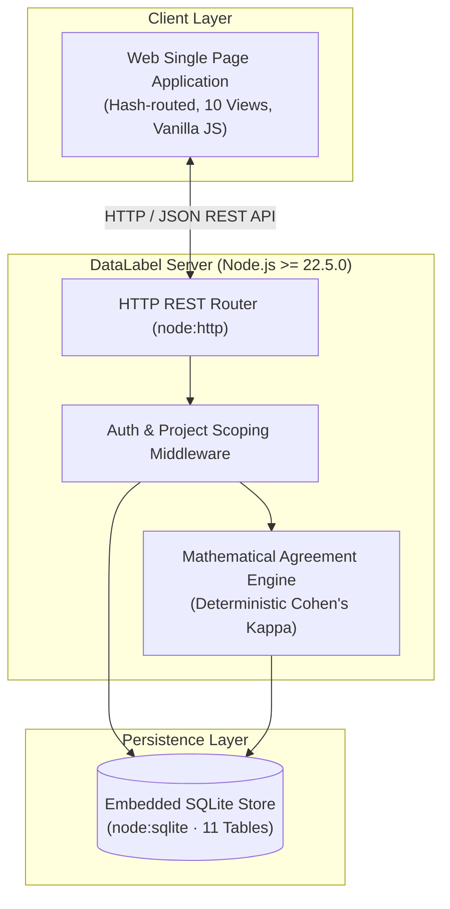
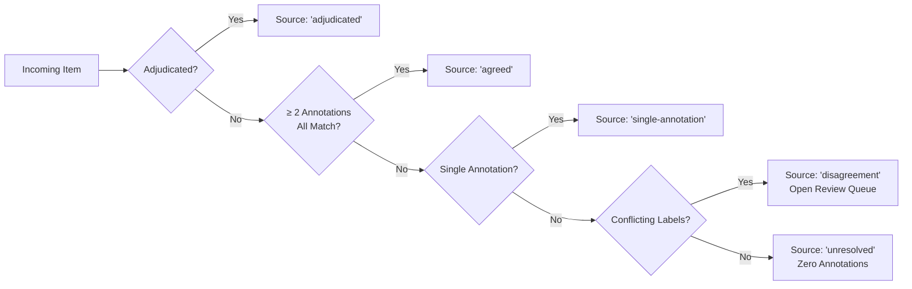
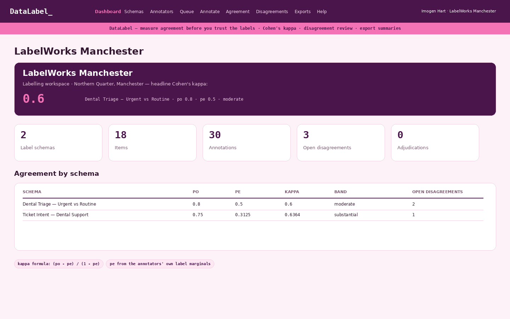
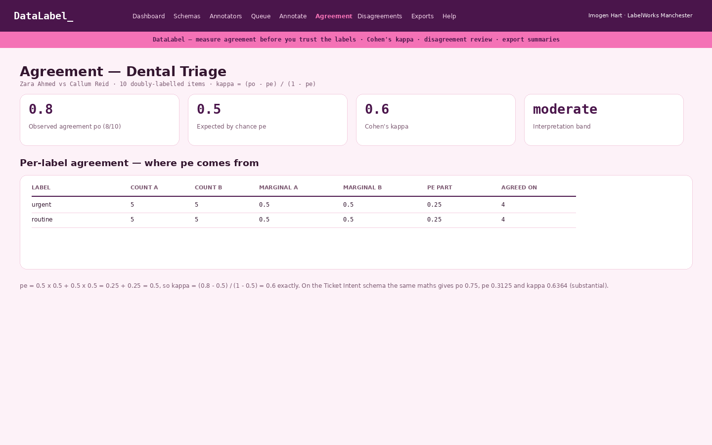
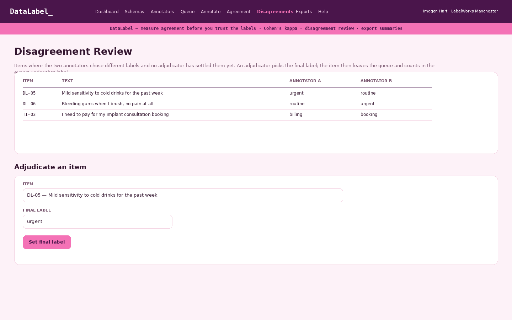
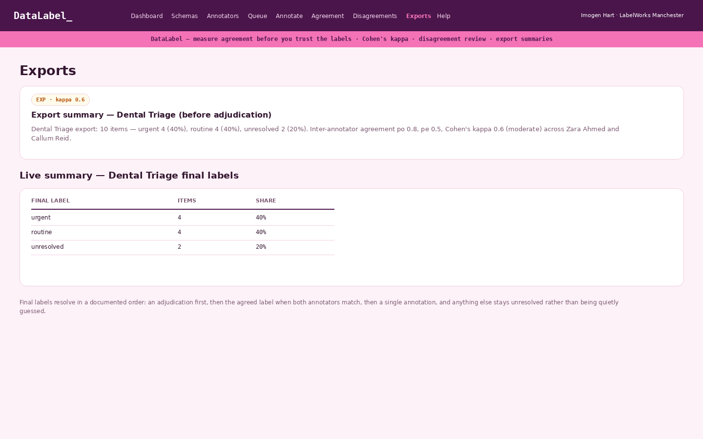

<div align="center">

# 🏷️ DataLabel — Enterprise Annotation & Agreement Studio

### *Deterministic Inter-Annotator Agreement Engine, Cohen's Kappa Analysis, Disagreement Adjudication & Audit-Ready Dataset Exports.*

[](https://github.com/serviceprovidermanchester/spm-aidev-datalabel/actions)
[](LICENSE)
[](CONTRIBUTING.md)
[](https://nodejs.org/)
[](https://www.sqlite.org/)
[](https://www.spmanchester.com)

<p align="center">
  <strong>Built with ❤️ by <a href="https://www.spmanchester.com/">SPManchester Private Limited</a></strong><br>
  <em>Architected and maintained by Sayed Mudassar Akbar</em>
</p>

[Key Features](#-key-features) •
[Architecture](#-architecture) •
[Quick Start](#-quick-start) •
[Mathematical Engine](#-mathematical-agreement-engine) •
[API Reference](#-rest-api-overview) •
[Docker Deployment](#-docker-deployment) •
[Company Portfolio](#-about-spmanchester-private-limited)

---

</div>

## 📌 Executive Overview

In modern machine learning and LLM fine-tuning pipelines, **training data quality is commonly assumed rather than scientifically measured**. 

A team can run two human annotators through a labeling queue and observe a superficial "90% raw agreement". However, if both annotators lean heavily on the majority label, **most of that agreement occurs purely by chance**. The downstream model inherits hidden noise, poisoning its evaluation benchmarks and capping its predictive accuracy.

**DataLabel** is an enterprise-grade annotation and agreement studio developed by **[SPManchester Private Limited](https://www.spmanchester.com/)**. It eliminates label ambiguity by coupling an intuitive multi-annotator interface with a pure, deterministic mathematical engine that computes **Cohen's Kappa ($\kappa$)** alongside per-label marginal distributions.

Disagreements are automatically surfaced as actionable review queues for senior adjudicators, and final exports report the exact provenance of every label while transparently accounting for unresolved items.

---

## 🌟 Key Features

- **🎯 Deterministic Agreement Mathematics:** Calculates observed agreement ($p_o$), expected chance agreement ($p_e$), and Cohen's kappa ($\kappa$) with Landis & Koch interpretation bands.
- **📊 Granular Marginal Transparency:** Details individual annotator marginal contributions and per-label agreement vs solo counts ($A\text{-only}$ and $B\text{-only}$).
- **⚖️ Senior Adjudication Queue:** Unresolved disagreements transition into a dedicated review queue where senior adjudicators record final labels with audit rationale notes.
- **📁 Transparent Final-Label Export Engine:** Implements a strict four-tier precedence hierarchy (`Adjudicated` > `Unanimous Agreement` > `Single Annotation` > `Unresolved`).
- **🛡️ Multi-Tenant Workspace Isolation:** Robust token authentication with role-based permissions (`owner` vs `staff`) and row-level scoping (`project_id`).
- **⚡ Zero External Dependencies:** Runs entirely on Node.js built-ins (`node:http`, `node:sqlite`, `node:crypto`) for maximum speed, security, and portability.
- **🖥️ 10-View Real-Time Console:** Complete hash-routed SPA wired directly to live REST endpoints with zero compilation steps.

---

## 🏗️ System Architecture



### Final-Label Precedence Flowchart



---

## 💻 Tech Stack

| Component | Technology | Rationale |
| :--- | :--- | :--- |
| **Runtime** | Node.js (>= 22.5.0) | High-performance asynchronous runtime utilizing native ES/CommonJS modules. |
| **API Server** | `node:http` | Standard library HTTP server offering zero-dependency stability and low latency. |
| **Database** | `node:sqlite` (SQLite 3) | Native embedded SQL engine with atomic transactions and zero network overhead. |
| **Cryptography** | `node:crypto` | High-security scrypt hashing and cryptographically secure session token generation. |
| **Frontend** | Semantic HTML5 / CSS3 / Vanilla JS | Lightweight, accessible 10-view SPA with responsive design and instant load times. |
| **Testing** | Custom Native Test Harness | Comprehensive integration suite executing 54 checks against temporary databases. |

---

## 📸 Interface Screenshots

The Web Console provides complete visibility across the entire data labeling lifecycle:

| View | Screenshot | Focus Area |
| :--- | :--- | :--- |
| **Dashboard** |  | Workspace KPIs, headline Cohen's kappa, queue health |
| **Agreement Analysis** |  | Observed agreement, chance agreement, marginal breakdown |
| **Disagreements Queue** |  | Conflicting items flagged for senior adjudicator review |
| **Dataset Export** |  | Final label distributions with honest unresolved shares |

---

## 🚀 Quick Start Guide

### Prerequisites
- **Node.js**: Version 22.5.0 or later.
- **Git**: Version 2.20 or later.

### 1. Clone the Repository
```bash
git clone https://github.com/serviceprovidermanchester/spm-aidev-datalabel.git
cd spm-aidev-datalabel
```

### 2. Configure Environment
Copy the example environment configuration:
```bash
cp .env.example .env
```
*(Default settings bind to `0.0.0.0:4000` with local file persistence).*

### 3. Verify Code Integrity & Execute Tests
Run the built-in syntax validator and end-to-end integration test harness:
```bash
# Verify syntax across all modules
npm run check

# Run the 54-case live HTTP test suite
npm test
```

### 4. Launch DataLabel Studio
```bash
npm start
```
The server will boot and display:
```
DataLabel listening on http://0.0.0.0:4000
Console: http://0.0.0.0:4000/ - Health: GET /health
```
Navigate to `http://localhost:4000` in your web browser.

### 5. Seed Demonstration Workspace
To populate the database with the canonical Dental Triage and Ticket Intent fixtures:
```bash
npm run seed
```
**Default Credentials:**
- **Email:** `owner@labelworks.co.uk`
- **Password:** `Owner2026!`

---

## 📐 Mathematical Agreement Engine

DataLabel implements Cohen's kappa ($\kappa$) over items doubly-labelled by two annotators:

$$\kappa = \frac{p_o - p_e}{1 - p_e}$$

Where:
- **$p_o$ (Observed Agreement):** The fraction of items where annotator $A$ and annotator $B$ assigned identical labels.
- **$p_e$ (Expected Agreement by Chance):** $\sum_{l \in L} \text{marginal}_A(l) \times \text{marginal}_B(l)$, derived from each annotator's independent label distribution.

### Landis & Koch Interpretation Scale
- **$< 0.00$:** Poor agreement
- **$0.00 - 0.20$:** Slight agreement
- **$0.21 - 0.40$:** Fair agreement
- **$0.41 - 0.60$:** Moderate agreement
- **$0.61 - 0.80$:** Substantial agreement
- **$0.81 - 1.00$:** Almost perfect agreement

### Verified Canonical Fixture
In the seeded **Dental Triage** benchmark:
- 10 patient inquiries doubly-labelled.
- Both annotators assigned 5 `urgent` and 5 `routine` labels ($\text{marginal} = 0.5$).
- Annotators agreed on 8 items: $p_o = 0.8$.
- Chance agreement: $p_e = (0.5 \times 0.5) + (0.5 \times 0.5) = 0.5$.
- Exact Cohen's Kappa: $\kappa = \frac{0.8 - 0.5}{1 - 0.5} = \mathbf{0.6000}$ (Moderate).

---

## 📡 REST API Overview

DataLabel exposes 26 RESTful endpoints scoped under `/api/v1`, plus a `/health` endpoint:

| Category | Endpoint | Method | Description |
| :--- | :--- | :---: | :--- |
| **System** | `/health` | `GET` | Health check and database record counts |
| **Auth** | `/api/v1/auth/register` | `POST` | Register owner account & new workspace |
| **Auth** | `/api/v1/auth/login` | `POST` | Authenticate with scrypt password |
| **Auth** | `/api/v1/auth/me` | `GET` | Read current user profile |
| **Schemas** | `/api/v1/schemas` | `GET` | List label schemas in project |
| **Schemas** | `/api/v1/schemas` | `POST` | Create schema (min. 2 labels) |
| **Items** | `/api/v1/schemas/:id/items` | `POST` | Append item snippet to schema |
| **Annotators** | `/api/v1/annotators` | `GET` | List annotators and adjudicators |
| **Labelling** | `/api/v1/assignments` | `POST` | Assign item to annotator |
| **Labelling** | `/api/v1/annotations` | `POST` | Submit label and note |
| **Agreement** | `/api/v1/schemas/:id/agreement` | `GET` | Calculate $p_o$, $p_e$, marginals & kappa |
| **Adjudication** | `/api/v1/schemas/:id/disagreements`| `GET` | List open conflict queue |
| **Adjudication** | `/api/v1/adjudications` | `POST` | Set final adjudicated label & note |
| **Export** | `/api/v1/schemas/:id/export-summary`| `GET` | Generate provenance export distribution |

*For complete endpoint request/response payloads, see [docs/API.md](docs/API.md).*

---

## 🐳 Docker Deployment

DataLabel is packaged with a lightweight, multi-stage Alpine Dockerfile.

### Using Docker Compose
```bash
# Build and run container in detached mode
docker compose up -d

# Check service logs
docker compose logs -f

# Stop container service
docker compose down
```

### Manual Docker Build
```bash
docker build -t spmanchester/datalabel:latest .
docker run -d -p 4000:4000 -v datalabel_data:/app/data spmanchester/datalabel:latest
```

---

## 🗺️ Enterprise Roadmap

- [x] Deterministic Cohen's kappa engine with Landis & Koch bands
- [x] Multi-tenant project data isolation via `project_id`
- [x] Four-tier final label provenance resolution
- [ ] **Hosted LLM Pre-labelling Integration:** Pluggable assistance seam for OpenAI, Anthropic, and Google Gemini models with human-in-the-loop confirmation.
- [ ] **Multi-Annotator Fleiss' Kappa:** Extension from pairwise agreement to $M > 2$ annotators.
- [ ] **Vector Deduplication:** Embedding-based near-duplicate detection via pgvector or Qdrant.
- [ ] **Direct JSONL/Parquet Streaming:** High-throughput streaming exports for HuggingFace and S3.

---

## 🤝 Contributing & Community

We welcome contributions from open-source developers and machine learning engineers!
- Review our [Contribution Guidelines](CONTRIBUTING.md) for branch and commit standards.
- Uphold community respect via our [Code of Conduct](CODE_OF_CONDUCT.md).
- Security researchers should consult our [Security Policy](SECURITY.md).

---

## 🏢 About SPManchester Private Limited

**[SPManchester Private Limited](https://www.spmanchester.com/)** is an engineering consultancy and software development firm based in Manchester, UK. We engineer enterprise-grade artificial intelligence tooling, cloud platforms, and data infrastructure.

- **Corporate Website:** [https://www.spmanchester.com/](https://www.spmanchester.com/)
- **Technical Contact:** [info@spmanchester.com](mailto:info@spmanchester.com)
- **Lead Architect:** **Sayed Mudassar Akbar**
- **Portfolio Focus:** Series 10 — AI Development Platform Series (PromptStudio, RagBase, EvalBench, VectorLab, TokenLab, AgentFlow, DataLabel, GuardRail, ModelRouter, FeedbackLoop).

---

## 📄 License

This project is licensed under the terms of the MIT License, with copyright assigned to **SPManchester Private Limited**. See [LICENSE](LICENSE) for full details.

```
Copyright (c) 2026 SPManchester Private Limited
Lead Architect: Sayed Mudassar Akbar
Website: https://www.spmanchester.com
Contact: info@spmanchester.com
```
